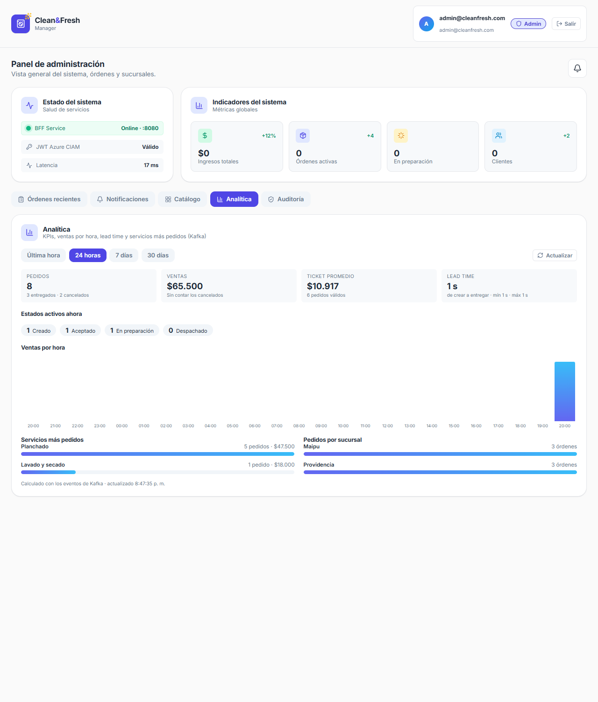
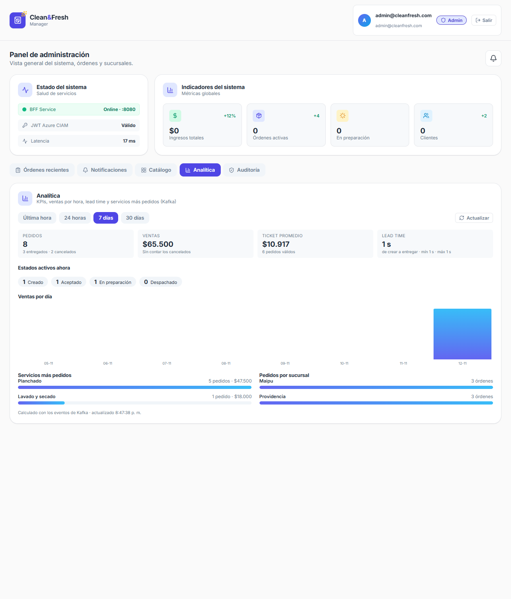
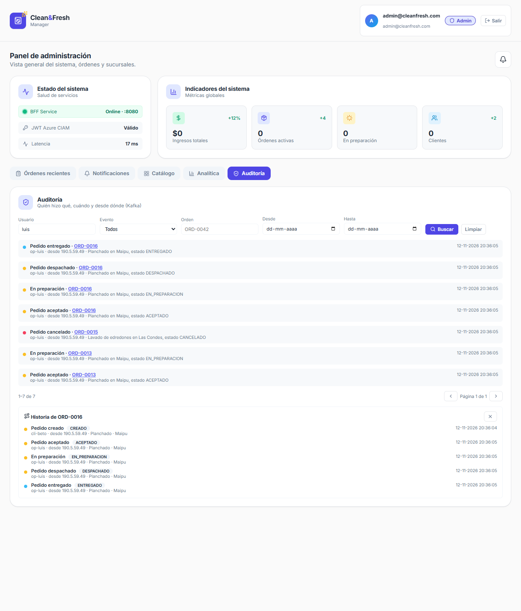

# Evidencia EP5 — Kafka

Salidas reales de las verificaciones, en el orden de las fases de la [Spec 044](specs/044-spec-kafka-eventos-y-analitica.md).

## 1. Clúster Kafka y Kafka-UI en local (fase 2: ACs 1, 2 y 3)

Docker Desktop en el PC del autor, `docker compose up -d` en `EP5/despliegue/kafka/` y en `EP5/despliegue/kafka-ui/`.

**Contenedores** (`docker compose ps`): los 3 Zookeeper y los 3 brokers en `healthy`; `kafka-init` termina solo.

```
kafka1 Up 19 seconds (healthy)      zk1 Up 25 seconds (healthy)
kafka2 Up 19 seconds (healthy)      zk2 Up 25 seconds (healthy)
kafka3 Up 19 seconds (healthy)      zk3 Up 25 seconds (healthy)
```

**Zookeeper: un líder y dos seguidores** (`echo srvr | nc localhost 2181 | grep Mode`):

```
zk1: Mode: follower
zk2: Mode: follower
zk3: Mode: leader
```

**Brokers del clúster** (`kafka-broker-api-versions`): `kafka1:29092 (id: 1)`, `kafka2:29092 (id: 2)` y `kafka3:29092 (id: 3)`.

**Tópicos** (`kafka-topics --describe`): 3 particiones y 3 réplicas, con los 3 brokers en el ISR de cada partición.

```
orders.events   PartitionCount: 3  ReplicationFactor: 3  Configs: min.insync.replicas=2,cleanup.policy=delete,retention.ms=604800000,...
  Partition: 0  Leader: 2  Replicas: 2,3,1  Isr: 2,3,1
  Partition: 1  Leader: 3  Replicas: 3,1,2  Isr: 3,1,2
  Partition: 2  Leader: 1  Replicas: 1,2,3  Isr: 1,2,3

audit.timeline  PartitionCount: 3  ReplicationFactor: 3  Configs: min.insync.replicas=2,cleanup.policy=compact,delete,retention.ms=2592000000,
                min.cleanable.dirty.ratio=0.1,delete.retention.ms=86400000,segment.ms=3600000,...

orders.events.reportes.DLT  PartitionCount: 3  ReplicationFactor: 3  Configs: ...cleanup.policy=delete,retention.ms=1209600000,...
```

Los otros dos DLT (`orders.events.auditoria.DLT` y `audit.timeline.auditoria.DLT`) se crean igual. Repetir `kafka-init` no cambia nada ("existe ...: se
corrigen sus configuraciones").

**Kafka-UI** (API de la interfaz, con la sesión iniciada con el usuario del `.env`):

```
cleanfresh  status= online  brokers= 3  topics= 5  partitions= 15
crear topico desde la UI: HTTP 200     detalle: prueba.ui particiones= 3 replicas= 3     borrar: HTTP 200
```

**Memoria** (`docker stats`): brokers 375, 375 y 348 MiB; Zookeeper 98, 102 y 106 MiB; Kafka-UI 446 MiB. Total cercano a 1,8 GB.

Nota: el primer `kafka-init` falló porque `kafka-topics` no acepta varias configuraciones en un solo `--config`; se corrigió creando el tópico sin ellas y
aplicándolas con `kafka-configs` (el script quedó repetible).

## 2. Administrador de Kafka y su ruta en el BFF (fase 3: AC 9)

`ms-cleanfresh-kafka-admin` (:8087, Spring Boot 4.1.1 con `kafka-clients` 4.2.1) contra el clúster local de la sección 1 (brokers 3.6). Se probó cada
operación con `curl` sobre el servicio levantado. Códigos y salidas reales:

**Lectura:** `GET /cluster` (id, controlador 1 y los 3 brokers), `GET /topics` (los 5 tópicos con su política y retención) y `GET /topics/orders.events`:

```
orders.events {'cleanup.policy': 'delete', 'min.insync.replicas': '2', 'retention.ms': '604800000'}
 p 0 lider 2 replicas [1, 2, 3] isr [1, 2, 3]     p 1 lider 3 ...     p 2 lider 1 ...
GET /metricas -> alerta False, particiones sub-replicadas 0, DLT con mensajes []
```

**Tópicos (crear, modificar, particiones, eliminar):**

```
crear prueba.admin (3x3 con config):  200  {"accion":"tópico creado","detalle":["prueba.admin: 3 particiones, 3 réplicas"]}
crear de nuevo:                       409  {"detail":"El tópico ya existe", ...}
modificar retention.ms (SET):         200   -> {'cleanup.policy': 'delete', 'retention.ms': '7200000'}
restablecer retention.ms:             200   -> {'cleanup.policy': 'delete'}
cleanup.policy=nada:                  400  Solicitud inválida: Invalid config value ... Invalid value nada for configuration cleanup.policy
subir a 5 particiones:                200  prueba.admin: 3 -> 5
bajar a 2:                            400  Solo se pueden aumentar las particiones: prueba.admin tiene 5 y se pidió 2
tópico inexistente:                   404
eliminar orders.events (base) sin force: 409  orders.events es un tópico base del sistema; para eliminarlo hay que indicar force=true
eliminar prueba.admin:                200
POST /topologia/base:                 200  (idempotente: "existe ...: configuración corregida" por cada tópico; crea el que falte)
```

**Consumer groups** con un consumidor real (`kafka-console-consumer`, 9 mensajes en `orders.events`, el grupo `demo-grupo` leyó 6):

```
GET /groups                -> [{"id":"demo-grupo","estado":"Empty","miembros":0}]
GET /groups/demo-grupo     -> estado Empty, lagTotal 3: orders.events-0 confirmado 4 final 4 lag 0 | -1 2/2 lag 0 | -2 0/3 lag 3
reset a earliest           -> lagTotal 9 [(0,0,4),(1,0,2),(2,0,3)]
reset a latest             -> lagTotal 0
reset a offset 1           -> lagTotal 6
destino inválido           -> 400          grupo inexistente -> 404
grupo-vivo (consumidor activo): estado Stable, asignador range, coordinador broker 3,
   miembro console-consumer /172.21.0.6 ['orders.events-0', 'orders.events-1', 'orders.events-2']
   eliminar con miembro activo -> 409      eliminar grupo vacío -> 200
```

Al terminar se eliminó y recreó `orders.events` (con `force=true` y `POST /topologia/base`) para dejarlo sin los mensajes de prueba.

**Pruebas automáticas:** `ms-cleanfresh-kafka-admin`: 36 en verde (servicio con `Admin` simulado: valores por defecto 3×3, `SET` y `DELETE` de configuraciones,
no reducir particiones, tópico base protegido, base idempotente, lag, grupo inexistente, validación de offsets, métricas con alerta, timeout a 503 y errores
de la solicitud tal cual; controlador: 409, 404, 400 y 503; propiedades). BFF: 78 en verde, 11 nuevas (`KafkaAdminRoutesTests`): sin token 401, Operador y
Cliente 403 en lectura y escritura (GET, POST, PUT y DELETE), Admin reenvía y devuelve el código del administrador tal cual, rutas ajenas 404 y el
repositorio responde 503 si el administrador no responde.

## 3. Productores: `orders` publica en Kafka (fase 4: ACs 4 y 5)

`orders` con `KAFKA_ENABLED=true` contra el clúster local (3 brokers) y PostgreSQL. Un pedido creado y llevado por sus estados con la API de `orders`
(con las cabeceras `X-Actor` y `X-Origen` que manda el BFF) produjo estos eventos en `orders.events`. Todos los de una orden cayeron en la misma partición
(la clave es el número de orden):

```
Partition:0  type:OrderCreated     ORD-0007  {"type":"OrderCreated","eventId":"9804949c-...","timestamp":"2026-11-12T23:14:06.832606Z","traceId":"582c12b4-...", ...}
Partition:0  type:OrderAccepted    ORD-0007
Partition:0  type:OrderPreparing   ORD-0007
Partition:0  type:OrderDispatched  ORD-0007
Partition:0  type:OrderDelivered   ORD-0007
Partition:0  type:OrderCreated     ORD-0008
Partition:0  type:OrderCancelled   ORD-0008
```

Un evento completo (DTO tipado `OrderEventMessage`, con las cabeceras `eventId`, `traceId` y `type` visibles en Kafka-UI):

```json
{ "type": "OrderDelivered", "eventId": "ebe50e71-...", "timestamp": "2026-11-12T23:14:07.202704Z", "traceId": "91cf15df-...", "correlationId": "ORD-0007",
  "payload": { "numeroOrden": "ORD-0007", "cliente": "cliente-uuid-demo", "clienteNombre": "cliente.demo@cleanfresh.com", "servicio": "Planchado",
               "sucursal": "Providencia", "total": 9500.0, "estado": "ENTREGADO", "fecha": "2026-11-12", "fechaHora": "2026-11-12T23:14:06.814177Z", "actor": "op-1234" } }
```

Y en `audit.timeline` (`AuditEntryMessage`), un registro por cada evento, con quién lo hizo y desde dónde (la clave es `orden:<número>:<eventId>`):

```
orden:ORD-0007:05e96d3b-...  | cliente-uuid-demo | OrderCreated    | ORD-0007 | origen 190.5.59.49 | ms-cleanfresh-orders
orden:ORD-0007:ecac94ad-...  | op-1234           | OrderAccepted   | ORD-0007 | origen 190.5.59.49 | ms-cleanfresh-orders
orden:ORD-0007:dc263f88-...  | op-1234           | OrderDelivered  | ORD-0007 | origen 190.5.59.49 | ms-cleanfresh-orders
orden:ORD-0008:bbff32eb-...  | op-1234           | OrderCancelled  | ORD-0008 | origen None        | ms-cleanfresh-orders
```

**Con Kafka caído no se bloquea nada.** Con los 3 brokers detenidos, crear una orden respondió igual y rápido, y el fallo quedó en el log con su contexto:

```
crear orden con Kafka caido: HTTP 201 en 69 ms
crear orden con Kafka caido: HTTP 201 en 20 ms
crear orden con Kafka caido: HTTP 201 en 20 ms
ERROR KafkaOrderEventPublisher : No se pudo publicar OrderCreated (ORD-0009) en orders.events; el cambio de la orden ya quedó guardado
ERROR KafkaOrderEventPublisher : No se pudo publicar OrderCreated (orden:ORD-0009:58068798-...) en audit.timeline; el cambio de la orden ya quedó guardado
```

Pruebas automáticas: `ms-cleanfresh-orders` 67 en verde (19 nuevas: eventos por estado, cabeceras, tópicos configurables, envío asíncrono que no bloquea, error de Kafka sin
propagarse, actor desde las cabeceras, varios publicadores a la vez); BFF 84 en esa fase (6 nuevas del interceptor `X-Actor`/`X-Origen`: toma el último valor de `X-Forwarded-For`,
limpia saltos de línea y acota el largo).

## 4. Consumidores: `reportes` y `auditoria` (fase 5: ACs 6, 7 y 8)

Los dos servicios contra el mismo clúster y PostgreSQL local (`reportes_db` y `auditoria_db`), con `KAFKA_ENABLED=true`.

**Reconstruyen la historia desde Kafka** (grupo nuevo, `auto.offset.reset=earliest`): al arrancar ya veían los 7 eventos que `orders` había publicado antes.

```
reportes  /api/reportes/kpis?range=last24h -> pedidos 2, no cancelados 1, ventas 9500.0, entregados 1, cancelados 1, leadTime {muestras 1}
auditoria /api/auditoria -> total 7 (OrderCancelled ORD-0008, OrderCreated ORD-0008, OrderDelivered ORD-0007, ... , OrderCreated ORD-0007)
auditoria /api/auditoria/ordenes/ORD-0007:
   23:14:06 OrderCreated    CREADO          por cliente-uuid-demo desde 190.5.59.49
   23:14:07 OrderAccepted   ACEPTADO        por op-1234 desde 190.5.59.49
   23:14:07 OrderPreparing  EN_PREPARACION  por op-1234 desde 190.5.59.49
   23:14:07 OrderDispatched DESPACHADO      por op-1234 desde 190.5.59.49
   23:14:07 OrderDelivered  ENTREGADO       por op-1234 desde 190.5.59.49
```

**Reportes con pedidos nuevos** (5 pedidos más en distintas sucursales y servicios, algunos entregados, uno cancelado):

```
KPIs 24h: pedidos 7, no cancelados 5, ventas 56000.0, ticket promedio 11200.0, entregados 3, cancelados 2
          leadTime {promedioMin 0.02, minimoMin 0.01, maximoMin 0.02, muestras 3}
          estadosActivos {CREADO 0, ACEPTADO 1, EN_PREPARACION 1, DESPACHADO 0}
top servicios 7d: Planchado 4 pedidos 38000.0 | Lavado y secado 1 pedido 18000.0
por sucursal: Providencia 3 | Maipu 2
ventas por hora (24h): 25 filas (una por hora, con ceros); la última: 23:00 -> 5 pedidos 56000.0
```

**Filtros de la auditoría** (línea de tiempo del más reciente al más antiguo, paginada):

```
usuario=luis                 -> 7 registros (op-luis)        tipo=OrderCancelled -> 2        entidadId=ORD-0016 -> 5
desde=2026-11-12&hasta=2026-11-12&tamano=2 -> total 24, pagina 0, devueltos 2
usuario=ana&tipo=OrderAccepted -> 2 (op-ana: ORD-0014 y ORD-0012)
desde=ayer -> 400     desde>hasta -> 400     orden inexistente -> 404     POST -> 405     DELETE -> 405
```

**Consumer groups** (vistos con `ms-cleanfresh-kafka-admin`, `GET /api/kafka/groups/{id}`): dos grupos independientes, cada uno con todas las particiones y lag 0.

```
reportes-kpis      Stable | asignador cooperative-sticky | lag total 0 | 3 miembros: ms-cleanfresh-reportes-0 [orders.events-0], -1 [orders.events-1], -2 [orders.events-2]
auditoria-registro Stable | asignador cooperative-sticky | lag total 0 | 6 miembros: audit.timeline-0/1/2 y orders.events-0/1/2 (una partición por hilo)
```

**Resiliencia: una segunda instancia de `reportes` y la caída de la primera.** Al levantar la instancia B (puerto 8094) el grupo pasó a 4 miembros con la primera instancia
conservando las 3 particiones (asignación "sticky") y B en espera. Al detener la instancia A (puerto 8084), B tomó las 3 particiones y siguió procesando sin perder nada:

```
orden nueva con la instancia A detenida: ORD-0017
instancia B (puerto 8094): pedidos 8 | ventas 65500.0 | estadosActivos {CREADO 1, ACEPTADO 1, EN_PREPARACION 1, DESPACHADO 0}
reportes-kpis  Stable | miembros 1 | lag total 0 | reportes-instancia-b-0 [orders.events-0, orders.events-1, orders.events-2]
```

**Mensajes malos al DLT.** Se enviaron a `orders.events` un texto que no es JSON y un evento con tipo desconocido (`OrderInventado`). Los dos consumidores siguieron
procesando lo demás y cada uno mandó los dos a su propio DLT, con el contexto en el log:

```
Mensaje NO PROCESADO de orders.events (partición 2, offset 5, clave ORD-0100) va a orders.events.reportes.DLT:  StreamReadException: Unrecognized token 'esto' ...
Mensaje NO PROCESADO de orders.events (partición 2, offset 6, clave ORD-0100) va a orders.events.reportes.DLT:  EventoInvalidoException: tipo de evento desconocido: OrderInventado
Mensaje NO PROCESADO de orders.events (partición 2, offset 5, clave ORD-0100) va a orders.events.auditoria.DLT: StreamReadException: Unrecognized token 'esto' ...
Mensaje NO PROCESADO de orders.events (partición 2, offset 6, clave ORD-0100) va a orders.events.auditoria.DLT: EventoInvalidoException: tipo de evento desconocido: OrderInventado

GET /api/kafka/metricas -> hayAlerta True | DLT con mensajes ['orders.events.auditoria.DLT', 'orders.events.reportes.DLT']  (2 mensajes en cada uno)
```

En el DLT quedó el mensaje original (`esto no es json`), con las cabeceras `kafka_dlt-exception-fqcn` (`DeserializationException` y `ListenerExecutionFailedException`),
`kafka_dlt-exception-stacktrace`, `kafka_dlt-original-topic` (`orders.events`) y el grupo (`reportes-kpis`).

Pruebas automáticas: `ms-cleanfresh-reportes` 30 en verde y `ms-cleanfresh-auditoria` 28, cada una con una prueba sobre un **Kafka embebido real** (eventos buenos, repetidos, JSON roto y
contrato incumplido: se comprueba que lo bueno se guarda aunque haya malos en medio, que el repetido no se duplica y que los malos llegan al DLT con su error). BFF: 92 en verde.

Nota: la primera vez que se reinició Docker, los brokers se reiniciaron un par de veces antes de estabilizarse (ZooKeeper tardó en liberar los registros de la sesión anterior); `restart: unless-stopped`
los recuperó solos, con los tópicos intactos y sin particiones sub-replicadas.

## 5. Panel Admin con analítica y auditoría reales (Spec 045)

Chrome contra una copia del frontend (puerto 3010) con una sesión Admin simulada y un proxy que hace de BFF y le sirve los datos **reales** de `reportes` y `auditoria` (los eventos de las secciones 3 y 4).

**Analítica** (24 horas): 8 pedidos (3 entregados, 2 cancelados), ventas $65.500, ticket promedio $10.917, lead time, estados activos (1 creado, 1 aceptado, 1 en preparación), ventas por hora en hora local, servicios más pedidos y pedidos por sucursal.



Con el rango de 7 días el gráfico pasa a agruparse por día: 

**Auditoría**: filtro por usuario `luis` (7 registros, de op-luis, con la IP de origen), lista paginada y, al pulsar una orden, su historia completa (creada por `cli-beto`, luego aceptada, preparada, despachada y entregada por `op-luis`).



Compilación: `CI=true npm run build` → "Compiled successfully" (el linter trata las advertencias como error). Pruebas de lógica pura del frontend: 46 en verde (23 nuevas de `utils/reports`: formato de minutos y dinero, barras, ventas por hora y por día, estados activos, etiquetas de eventos, parámetros de filtro y paginado).

## 6. RabbitMQ no se ve afectado (AC 10 de la Spec 044)

`orders` local contra el RabbitMQ y el Kafka locales, con `RABBIT_ENABLED=true`: un pedido con `KAFKA_ENABLED=true` y otro con `KAFKA_ENABLED=false`.

```
orders con RABBIT_ENABLED=true y KAFKA_ENABLED=true : orden ORD-0018 -> q.cmd.kitchen 0 -> 1 | eventos en orders.events 27 -> 28
orders con RABBIT_ENABLED=true y KAFKA_ENABLED=false: orden ORD-0019 -> q.cmd.kitchen 1 -> 2 | eventos en orders.events 28 -> 28
Estado final de las colas (tras esperar el refresco de estadísticas del panel): q.cmd.email 2 | q.cmd.kitchen 2 | q.cmd.invoice 0
```

Con Kafka encendido, `orders` publica en los dos sistemas; con Kafka apagado, RabbitMQ recibe exactamente los mismos comandos (aviso y ticket de taller) y no se publica nada en Kafka. Las 18 pruebas de
`RabbitOrderEventPublisherTests` de `orders` siguen en verde y `OrdenEventListener` llama a todos los publicadores activos, cada uno con su propio manejo de errores. Los scripts de EP2
(`verificar.sh`, `verificar-flujo.sh` y `demo-notificaciones.sh`) se repetirán en AWS (Spec 047).

## 7. Scripts de despliegue y verificación (preparación de la Spec 047)

**`verificar-kafka.sh --caida`** contra el clúster local (con el administrador y los dos consumidores levantados), todo en "OK":

```
1) Zookeeper: 3 nodos, un líder y dos seguidores            OK   1 líder y 2 seguidores
2) Brokers: 3 en el clúster                                  OK   3 brokers: kafka1=1 kafka2=2 kafka3=3
3) Tópicos del sistema: 3 particiones, 3 réplicas, política y retención
   OK   orders.events: 3 particiones, 3 réplicas, delete, retención 604800000 ms, min.insync.replicas=2
   OK   audit.timeline: 3 particiones, 3 réplicas, compact,delete, retención 2592000000 ms, min.insync.replicas=2
   OK   orders.events.reportes.DLT / orders.events.auditoria.DLT / audit.timeline.auditoria.DLT: 3 particiones, 3 réplicas, delete, 1209600000 ms
4) Réplicas sincronizadas                                    OK   ninguna partición con réplicas sin sincronizar
5) Envío y lectura con acks=all (tópico temporal)            OK   un mensaje publicado con acks=all se leyó de vuelta
6) Caída de un broker: el sistema sigue                      OK   con kafka3 detenido se publicó y se leyó (acks=all con min.insync.replicas=2)
                                                             OK   kafka3 volvió y se resincronizó (sin particiones sub-replicadas)
7) Administrador de Kafka                                    OK   ve los 3 brokers · lista los 5 tópicos · POST /topologia/base idempotente (200)
8) Consumidores                                              OK   grupo reportes-kpis: Stable, lag 0 · grupo auditoria-registro: Stable, lag 0
Todo OK
```

**`rds-crear-bases.sh`** contra un PostgreSQL limpio: crea los roles `reportes_user` y `auditoria_user` y sus bases con ellos como dueños; una segunda ejecución no cambia nada (repetible); y el aislamiento
funciona: `reportes_user` entra a `reportes_db` y a `auditoria_db` no (`permission denied for database`).

**Compose de aplicaciones** (`EP2/despliegue/docker-compose.yml`, ahora con 7 servicios) validado con `docker compose config` usando las variables nuevas de `.env.example`.
